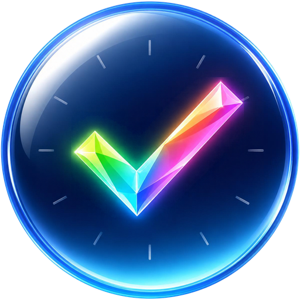
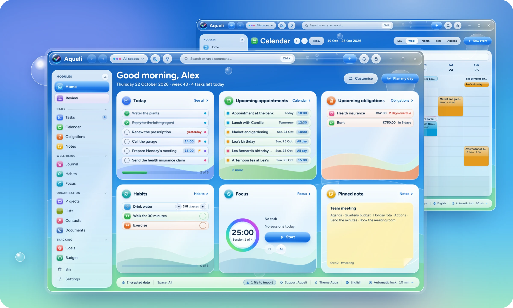
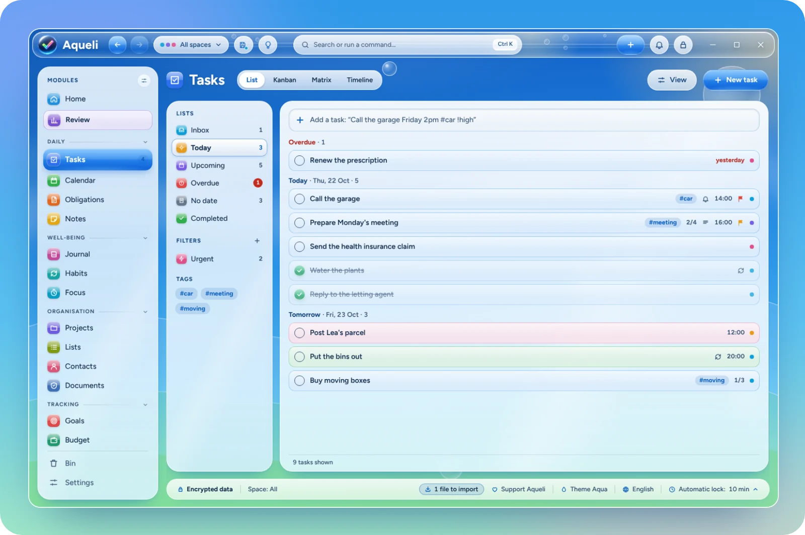
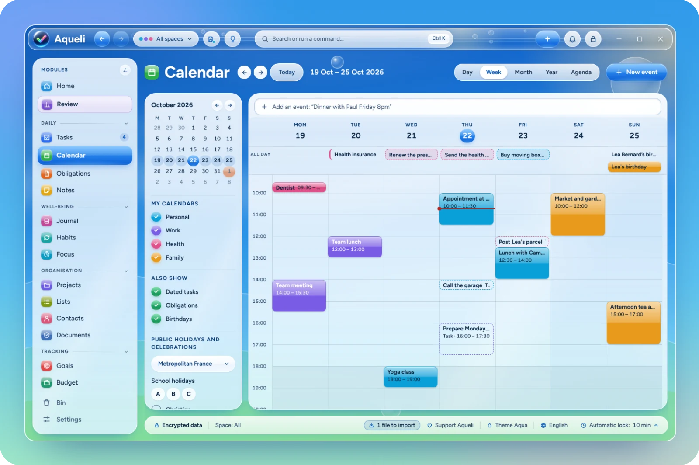
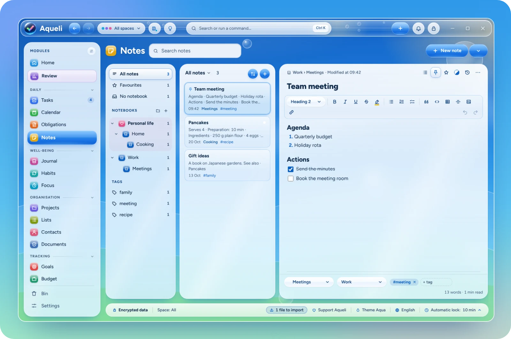
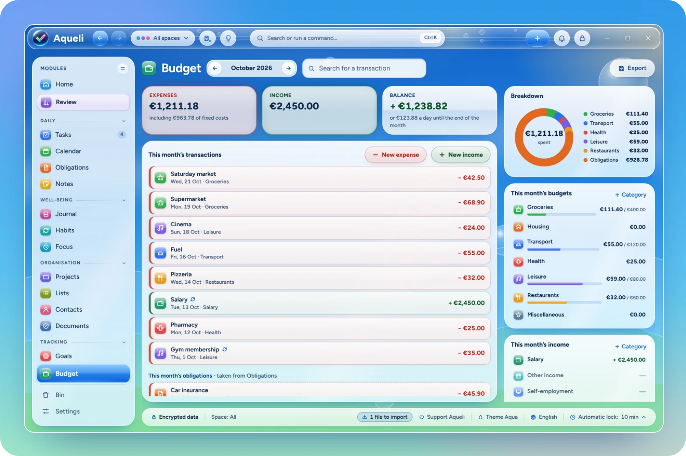
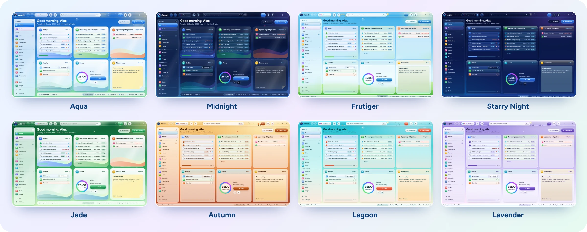

<p align="center">
  
</p>

<h1 align="center">Aqueli</h1>

<p align="center">
  <strong>A private, all-in-one organiser for Windows.<br>Tasks, calendar, notes, habits and budget, entirely offline.</strong>
</p>

<p align="center">
  <a href="https://github.com/Areemi-app/aqueli/releases/latest"></a>
  <a href="https://github.com/Areemi-app/aqueli/releases"></a>
  
  <a href="LICENSE"></a>
</p>

<p align="center">
  <a href="https://github.com/Areemi-app/aqueli/releases/latest"><strong>Download</strong></a> ·
  <a href="#features">Features</a> ·
  <a href="#privacy">Privacy</a> ·
  <a href="#building-from-source">Build from source</a> ·
  <a href="#support">Support</a>
</p>

<p align="center">
  <picture>
    <source media="(prefers-color-scheme: dark)" srcset="docs/images/hero-dark.webp">
    
  </picture>
</p>

Aqueli brings the everyday pieces of a personal life into one desktop app: what there is to do, where to be, what to remember, what to pay and how the week went. Everything is stored on your PC, in an encrypted database that only your password opens. There is no account to create, no cloud and no subscription.

The interface takes its cue from the glossy, sky-blue look of the late 2000s, redrawn for Windows 11: frosted glass, soft light and bright colours, in 31 themes.

## Download

Get the installer (`Aqueli_x.y.z_x64-setup.exe`) from the [latest release](https://github.com/Areemi-app/aqueli/releases/latest) and run it. It installs Aqueli for your Windows user account and does not need administrator rights. The installer starts by asking for your language, and Aqueli opens in the same language.

**Requirements:** Windows 11, 64-bit. Windows 10 may work but is not tested.

> [!NOTE]
> The installer is not code-signed yet. Windows SmartScreen may show "Windows protected your PC" the first time: choose **More info**, then **Run anyway**. Each release lists the SHA-256 checksum of the installer, which you can compare with the output of `Get-FileHash` in PowerShell.

## Features

Fifteen modules, grouped in the sidebar. Hide the ones you do not use in Settings › Modules.

<table>
  <tr>
    <td width="33%"> <b>Home</b><br><sub>Today at a glance, in cards you arrange and resize.</sub></td>
    <td width="33%"> <b>Tasks</b><br><sub>Natural-language entry, subtasks, repeats and reminders. List, board and matrix views.</sub></td>
    <td width="33%"> <b>Calendar</b><br><sub>Day, week, month and year views, with public and school holidays.</sub></td>
  </tr>
  <tr>
    <td> <b>Obligations</b><br><sub>Bills, subscriptions, contracts and papers, with reminders before each deadline.</sub></td>
    <td> <b>Notes</b><br><sub>Headings, checklists and tables, notebooks, links between notes and version history.</sub></td>
    <td> <b>Journal</b><br><sub>One page a day, with mood, energy and gratitude.</sub></td>
  </tr>
  <tr>
    <td> <b>Habits</b><br><sub>Yes/no or numeric habits, streaks, records and a year map.</sub></td>
    <td> <b>Focus</b><br><sub>25/5, 50/10 or custom cycles with calm soundscapes. Time is logged on the task.</sub></td>
    <td> <b>Projects</b><br><sub>A project's tasks, notes and documents, its progress and reusable templates.</sub></td>
  </tr>
  <tr>
    <td> <b>Lists</b><br><sub>Shopping, books, films or gifts, with custom columns and a gallery view.</sub></td>
    <td> <b>Contacts</b><br><sub>Contact cards, birthdays in the calendar and the history of linked items.</sub></td>
    <td> <b>Documents</b><br><sub>Important files kept inside the encrypted database, with expiry reminders.</sub></td>
  </tr>
  <tr>
    <td> <b>Goals</b><br><sub>Goals for the year, quarter or month, with steps and automatic progress.</sub></td>
    <td> <b>Budget</b><br><sub>A monthly budget by category, recurring items and bank statement import.</sub></td>
    <td> <b>Review</b><br><sub>A guided weekly review, charts for the week, month and year, and a monthly PDF report.</sub></td>
  </tr>
</table>

And around them:

- **Encrypted by default.** Each account is a SQLCipher database (AES-256), opened by a key derived from your password with Argon2id. A 24-character recovery key is the only other way in. Windows Hello unlocks it day to day.
- **Works offline.** Aqueli makes no network connections. Nothing is sent anywhere, and no internet connection is ever needed.
- **Keyboard first.** A command palette (<kbd>Ctrl</kbd>+<kbd>K</kbd>), shortcuts you can change, <kbd>Ctrl</kbd>+<kbd>Z</kbd> for every change to your data, and a quick capture window from anywhere in Windows (<kbd>Ctrl</kbd>+<kbd>Alt</kbd>+<kbd>A</kbd>).
- **Everything connected.** Link a task to a note, an event to a contact, a bill to its contract, and find anything from one search bar.
- **Import and export.** Bring in tasks, events, notes, contacts and more from Excel, CSV, text, Markdown, `.ics` and `.vcf` files, with a preview before anything is added. Export back to the same formats.
- **31 themes.** Light and dark, each with its own sky, illustrations and sounds. Themes can change with the time of day, the season or the holidays, and you can design your own.
- **17 languages,** chosen at installation and changeable at any time.
- **Several accounts on one PC,** each with its own password, data and backups.
- **Backups** to a folder or an external drive, and a 30-day bin for anything deleted.
- **Accessible.** Full keyboard navigation, a high-contrast mode that follows Windows, and options to reduce motion and transparency.

## Screenshots

<table>
  <tr>
    <td></td>
    <td></td>
  </tr>
  <tr>
    <td></td>
    <td></td>
  </tr>
</table>

<p align="center">
  
</p>

## Privacy

Aqueli does not collect anything. There is no account on a server, no telemetry, no analytics and no update check: the app does not open a single network connection. Your data lives in the Aqueli folder of your Windows user profile, in a database encrypted with your password, and only leaves it when you export a file or make a backup.

Because there is no server, there is no "forgot my password" link. Keep your recovery key somewhere safe: without the password or the key, the data cannot be read by anyone, including the author.

## Languages

English, Français, Español, Português (Brasil), Deutsch, Italiano, Nederlands, Polski, Русский, Українська, Türkçe, हिन्दी, Bahasa Indonesia, Tiếng Việt, 简体中文, 日本語 and 한국어.

The installer, the interface and the import guide are available in each of them. Corrections from native speakers are welcome: see [Contributing](#contributing).

## Building from source

You need Node.js 24, Rust (stable, MSVC toolchain), the Visual Studio Build Tools with the C++ workload, and Perl, which is used to build OpenSSL for SQLCipher. The build looks for a portable [Strawberry Perl](https://strawberryperl.com) in `..\outils\strawberry-perl`, next to the repository folder (see `.cargo/config.toml`). To use another Perl, set `OPENSSL_SRC_PERL` to its `perl.exe` before building.

```powershell
git clone https://github.com/Areemi-app/aqueli.git
cd aqueli
npm ci
npm run tauri dev
```

To run the tests and build the installer:

```powershell
npm test
cd src-tauri; cargo test; cd ..
npx tauri build --bundles nsis
```

The installer is written to `src-tauri\target\release\bundle\nsis\`.

The interface is written in React and TypeScript; the core, in Rust, is built on [Tauri](https://tauri.app).

## Contributing

Bug reports and suggestions are welcome in [Issues](https://github.com/Areemi-app/aqueli/issues). Please describe what you did, what you expected and what happened, and mention your Windows version and Aqueli version (Settings › About). Never attach your data folder or your recovery key.

Translations live in `src/i18n/locales/`, one file per language. If a word sounds wrong in your language, open an issue or a pull request with the corrected text.

## Support

Aqueli is free and made by one person. If it is useful to you, you can support its development on Ko-fi.

<a href="https://ko-fi.com/areemi"></a>

## License

Aqueli is free software, released under the [GNU General Public License v3.0 or later](LICENSE).

Made by Areemi.
